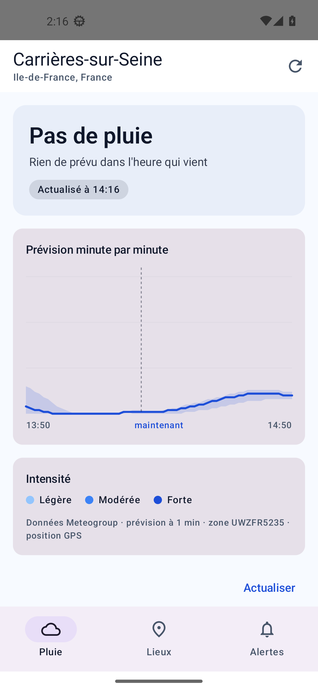

# Rain Today Lite

Réécriture moderne et minimale de l'application **Rain Today** (com.mg.raintoday),
construite autour de la même API de prévision de pluie à 1 minute de Meteogroup.
Écran unique centré sur une question : **est-ce qu'il va pleuvoir, et quand ?**

Licence MIT. Kotlin + Jetpack Compose, minSdk 26, targetSdk 35, aucune dépendance
aux services Google Play (localisation via `LocationManager`).

## Fonctionnalités

- Graphe de prévision minute par minute (bande min/max, courbe moyenne, repère
  « maintenant »), statut en une phrase (« Il pleut », « Pluie dans 12 min »,
  « Pas de pluie ») et niveau d'intensité.
- **Position GPS courante** : bouton « Utiliser ma position », nom du lieu obtenu
  par géocodage inverse du backend. La dernière position connue sert tout de suite
  (affichage en ~1 s), une position fraîche la remplace ensuite si elle a bougé de
  plus de 250 m ; réseau et GPS sont interrogés en parallèle, borne de 7 s.
- **Tirer vers le bas** sur l'écran pluie pour rafraîchir manuellement.
- **Lieux favoris** : recherche par nom (résultats du service Meteogroup),
  sélection courante, suppression.
- **Plages horaires d'alerte** : jours de la semaine + début/fin + prévenance.
  Une notification est émise si de la pluie est attendue pendant la plage
  (déjà en cours ou démarrant dedans). Contrôle en arrière-plan toutes les
  15 minutes via WorkManager, déduplication 90 min par règle, et bouton
  « Tester maintenant » pour déclencher un contrôle immédiat.
- Thème clair/sombre Material 3.



## API utilisée (lecture seule)

| Usage | Requête |
|---|---|
| Zone de pluie (UWZ) | `https://feed.alertspro.meteogroup.com/AlertsPro/AlertsProPollService.php?method=lookupCoord&lat&lon` |
| Série de pluie | `https://weatherpro.consumer.meteogroup.com/weatherpro/RainService.php?method=getRainChart&areaID=<UWZ…>` |
| Recherche / géocodage inverse | `https://weatherpro.consumer.meteogroup.com/weatherpro/SearchFeed.php?search=…` ou `?next=lon,lat` |

La réponse de `RainService.php` est un JSON de 61 échantillons espacés de
`interval` ms (60 000), `startdtg`/`creationdtg` en UTC (`yyyy-MM-dd HH:mm:ss`).
`avg`, `min`, `max` sont des entiers à normaliser : `(v - domainMin) / domainMax`.
Seuil de pluie = `0,25`, comme dans l'application d'origine.

## Architecture

```
data/      MeteogroupApi (OkHttp), RainRepository, SettingsRepository (DataStore)
domain/    RainAnalysis: Outlook (Dry/Raining/Starting), fenêtres d'alerte
platform/  LocationHelper (LocationManager), Notifications
work/      RainAlertWorker (CoroutineWorker), AlertScheduler (15 min)
ui/        Compose : RainTodayApp, HomeScreen, PlacesScreen, AlertsScreen, RainChart
```

Tout l'état persistant (lieux, règle d'alerte, zone UWZ mémorisée) tient dans un
seul blob JSON DataStore, sérialisé avec kotlinx.serialization.

## Compiler

Prérequis : JDK 17+, Android SDK avec `platforms;android-35` et
`build-tools;35.0.0`, puis `sdk.dir` dans `local.properties`.

```bash
./gradlew assembleDebug          # APK de test
./gradlew assembleRelease        # APK release (minifié)
./gradlew test                   # tests unitaires du domaine (seuils, fenêtres, jours)
```

Signature : placer `keystore/release.jks` (alias `raintoday`) à la racine, ou
définir `RT_STORE_PASSWORD`, `RT_KEY_ALIAS`, `RT_KEY_PASSWORD`. Sans keystore,
la release sort non signée.

```bash
mkdir -p keystore
keytool -genkeypair -v -keystore keystore/release.jks -alias raintoday \
  -keyalg RSA -keysize 4096 -validity 10000 \
  -storepass raintoday -keypass raintoday -dname "CN=Rain Today Lite"
```

## Limites connues

- L'API ne fournit qu'environ **15 min de passé et 45 min de futur** par zone :
  c'est un nowcast, pas une prévision horaire.
- La granularité des alertes en arrière-plan est celle de WorkManager
  (15 min minimum, et le système peut décaler). Pour une alerte à l'heure exacte
  il faudrait `AlarmManager.setExactAndAllowWhileIdle` + permission dédiée.
- La donnée est celle de la **zone UWZ** du point (par ex. `UWZFR5196`), pas du
  point exact : deux adresses d'une même zone partagent la même prévision.
- API non documentée, non officielle : elle peut disparaître ou changer de forme.
  L'application d'origine a d'ailleurs cessé de fonctionner pour cette raison
  (hôte mort codé en dur).

## Données et marques

Les données météo appartiennent à leurs producteurs (Meteogroup / nowinnov).
Ce projet n'est ni affilié ni approuvé par eux ; il consomme les mêmes points
d'accès publics que l'ancienne application, pour un usage personnel.
